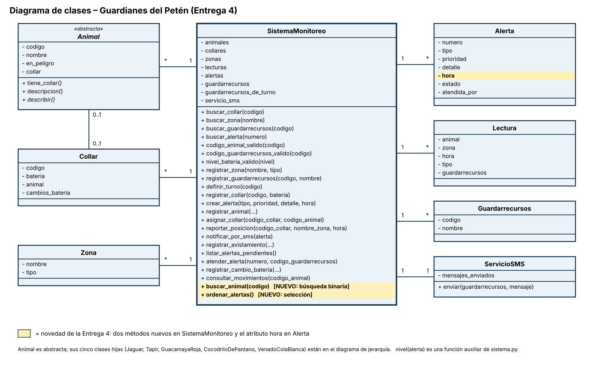

# Guardianes del Petén – Entrega 4

**Nombre:** Bryan Alexander Arita García
**Carné:** 202603057
**Grupo:** 2
**Fecha:** 4 de noviembre de 2026
**Curso:** Fundamentos de Programación 2 – Universidad Da Vinci de Guatemala

## Qué se agregó en esta entrega

En la clase central `SistemaMonitoreo` (archivo `sistema.py`):

1. **`ordenar_alertas()`**: ordena la lista de alertas con ordenamiento por selección escrito por mí, sin `sort()` ni `sorted()`. Primero van las alertas de prioridad alta y después las medias; si dos tienen la misma prioridad, va primero la de hora más temprana. Para comparar usa la función `nivel(alerta)`, que convierte la prioridad en número (alta = 1, media = 2).
2. **`buscar_animal(codigo)`**: primero ordena la lista de animales por código con selección y después busca con búsqueda binaria (`inicio`, `fin` y `medio`). Devuelve el animal, o `None` si no está.

Cambio pequeño que hizo falta: la clase `Alerta` ahora guarda su `hora`, porque se necesita para desempatar al ordenar. Por eso `crear_alerta` recibe la hora.

## Cómo ejecutar

```
python main.py
```

Al final, `main.py` intenta crear un `Animal` directo y da `TypeError` a propósito (Entrega 3: `Animal` es abstracta).

## Diagrama de clases actualizado

Los dos métodos nuevos están marcados en amarillo dentro de `SistemaMonitoreo`.



## Captura de la ejecución de main.py

Las dos pruebas: alertas antes y después de ordenar, y las tres búsquedas por código.


